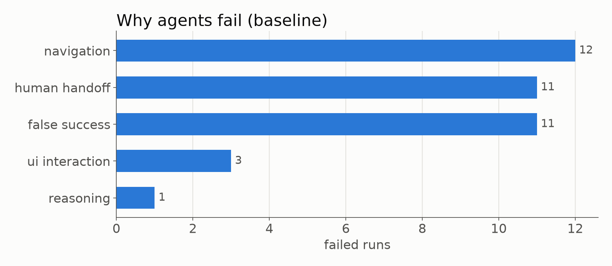
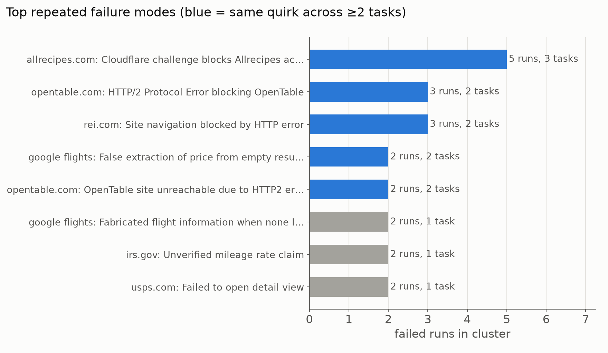
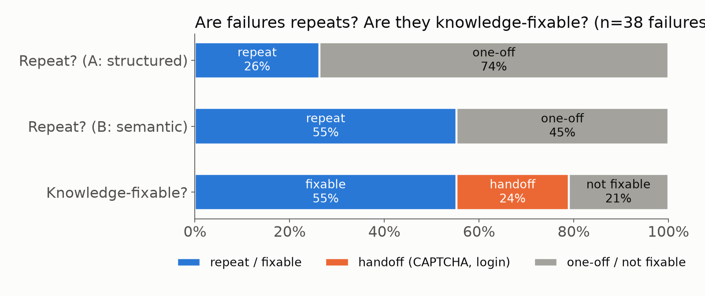
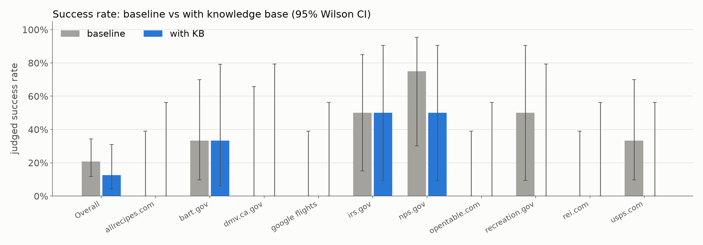
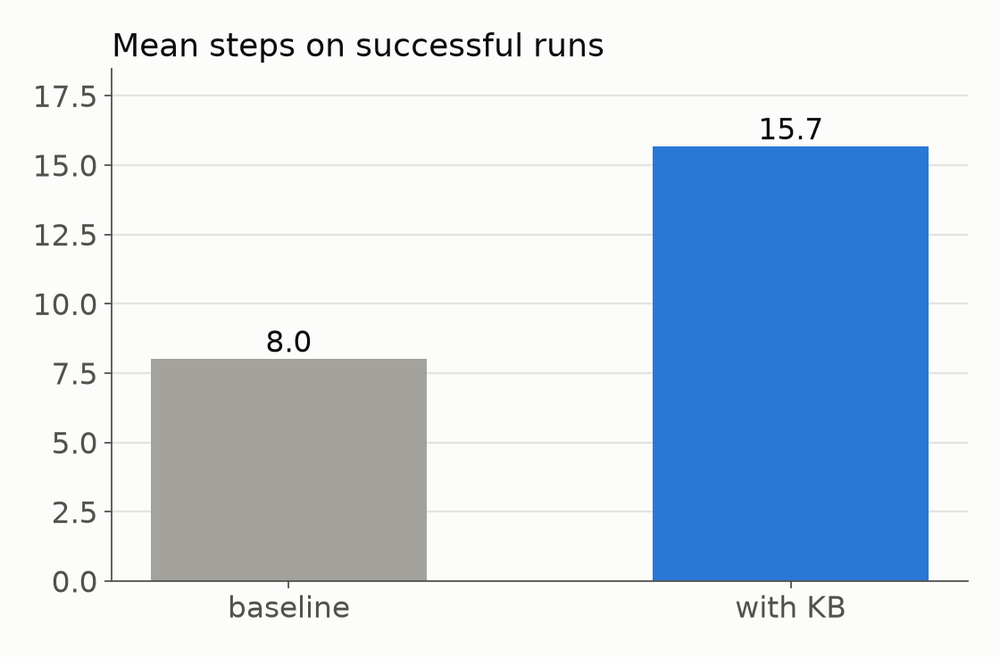
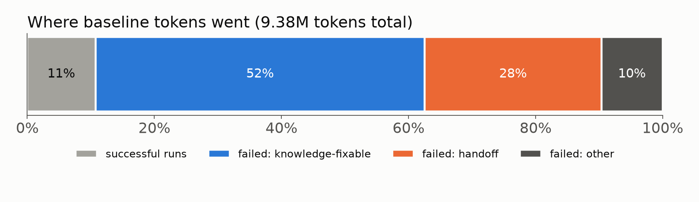
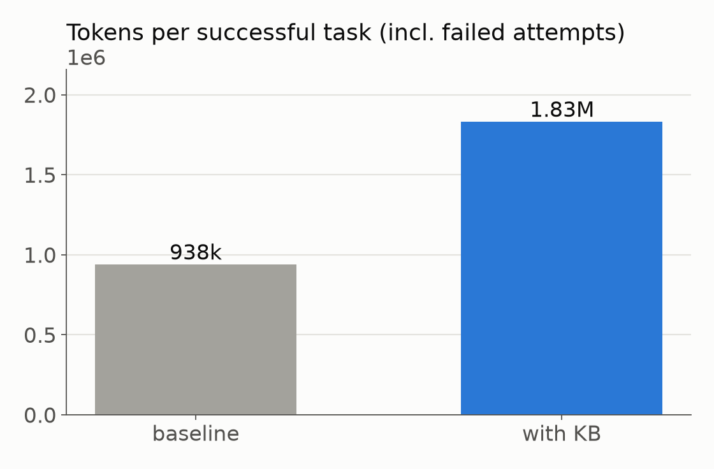

# Agents repeat the same web mistakes — and a shared knowledge base fixes many of them

*Small pilot. All numbers are generated from `data/experiment.db` by `scripts/make_report.py`.*

## 1. Headline

**Agents fail 79% of everyday web tasks (95% CI 66%–88%), and 55% of those failures are repeats (semantic clustering; 26% by the stricter structured key). 55% were preventable with a single shared note. With our knowledge base: 21% → 12% success, 96% more steps on successful runs.**

## 2. Setup

- **Tasks:** 24 everyday non-coding tasks on 10 live sites (allrecipes.com, bart.gov, dmv.ca.gov, google.com/travel/flights, irs.gov, nps.gov, opentable.com, recreation.gov, rei.com, usps.com).
- **Runs:** 2 reps per task per condition; baseline judged runs = 48 (+0 harness errors excluded).
- **Agent model:** `openai/gpt-oss-120b` via browser-use; **analysis/judge model:** `openai/gpt-oss-120b`.
- **Max steps:** 30, timeout 360 s, headless Chromium 1280×800.
- **Run window:** 2026-10-17T20:26:35.222301+00:00 → 2026-10-17T21:00:21.403436+00:00; relative dates resolved on 2026-10-17.
- **Judge validation:** judge not yet validated.

## 3. How often agents fail

- **Failure rate:** 79% (95% CI 66%–88%, n=48)
- **pass@1:** 21% (95% CI 12%–34%, n=48); **pass^k (all reps succeed):** 12% (95% CI 4%–31%, n=24)
- **Task flakiness (mixed outcomes):** 17% (95% CI 7%–36%, n=24)
- **False-success rate** (agent said done, judge said no): 55% (95% CI 35%–73%, n=22)
- **Terminal statuses:** blocked_captcha: 1, done: 46, max_steps: 1

| Site | Runs | pass@1 | pass^3 |
|---|---|---|---|
| allrecipes.com | 6 | 0% | 0% |
| bart.gov | 6 | 33% | 0% |
| dmv.ca.gov | 2 | 0% | 0% |
| google.com/travel/flights | 6 | 0% | 0% |
| irs.gov | 4 | 50% | 50% |
| nps.gov | 4 | 75% | 50% |
| opentable.com | 6 | 0% | 0% |
| recreation.gov | 2 | 50% | 0% |
| rei.com | 6 | 0% | 0% |
| usps.com | 6 | 33% | 33% |

## 4. Why they fail



- *allrecipes.com / human_handoff:* “Cloudflare's verification challenge blocked access to the Allrecipes recipe page, preventing the agent from retrieving and scaling the butter amount.”
- *bart.gov / ui_interaction:* “Typed the date and time into the departure fields, but the BART planner uses a custom calendar widget that ignores direct text entry, so the request defaulted to the current date (10/17/2026).”
- *bart.gov / navigation:* “The agent navigated to a parameterized BART planner URL that returned a Permission denied page, preventing it from retrieving trip results.”
- *dmv.ca.gov / false_success:* “Agent wrote a summary of eligibility and fee without locating that information on the page, resulting in unverifiable content.”
- *dmv.ca.gov / reasoning:* “Agent fabricated eligibility conditions and a $46 renewal fee despite the page only showing payment methods, resulting in an answer unsupported by extracted content.”

## 5. Failures repeat

- **Method A (structured key):** repeat-failure rate 26% (95% CI 15%–42%, n=38); cross-task repeat rate 16% (95% CI 7%–30%, n=38); 4 clusters of size ≥2.
- **Method B (semantic clusters):** repeat-failure rate 55% (95% CI 40%–70%, n=38); cross-task repeat rate 39% (95% CI 26%–55%, n=38); 8 clusters of size ≥2.



| Site | Cluster (Method B) | Failures | Tasks |
|---|---|---|---|
| allrecipes.com | Cloudflare challenge blocks Allrecipes access | 5 | 3 |
| opentable.com | HTTP/2 Protocol Error blocking OpenTable | 3 | 2 |
| rei.com | Site navigation blocked by HTTP error | 3 | 2 |
| google.com/travel/flights | False extraction of price from empty results | 2 | 2 |
| opentable.com | OpenTable site unreachable due to HTTP2 errors | 2 | 2 |

See `out/cluster_samples.md` for member causes of 5 random clusters (human sanity check).

## 6. Failures are knowledge-fixable

- **yes:** 55% (95% CI 40%–70%, n=38)
- **handoff:** 24% (95% CI 13%–39%, n=38)
- **no:** 21% (95% CI 11%–36%, n=38)



Example draft notes from the classifier:

> **bart.gov** — On bart.gov trip planner, the departure date and time must be entered using the calendar and time dropdown widgets; typing directly into the fields is ignored and defaults to today. Click the calendar icon, select the desired date (e.g., 10/28/2026), then choose the time from the dropdown before submitting.

> **bart.gov** — When using the BART trip planner, start from the main planner page (https://www.bart.gov/planner) and enter the origin, destination, date, and time in the form. Avoid constructing a direct URL with query parameters, as those URLs return a Permission Denied page without an active session.

> **bart.gov** — After selecting the origin (Downtown Berkeley) and destination (Embarcadero) stations, click the 'Calculate Fare' button before trying to read the fare; the fare appears only after this action.

## 7. The KB fixes them

- **Success rate:** baseline 21% (95% CI 12%–34%, n=48) → with KB 12% (95% CI 4%–31%, n=24).
- **Difference:** -8.3% (paired bootstrap over 24 tasks, 95% CI -22.9% to 4.2%).
- **Mean steps on successful runs:** 8.0 → 15.7 (96%).
- **Recovered tasks:** 10% (95% CI 3%–29%, n=21) of tasks that failed ≥1 baseline run improved: bart_03, nps_02.
- **Regressions (4):** bart_02 (50%→0%), nps_01 (100%→0%), recgov_01 (50%→0%), usps_02 (100%→0%).
- **KB size:** 17 frozen entries; 0 drafts rejected by the answer-leak check.





| Failure category (baseline) | Tasks | Baseline success | With-KB success |
|---|---|---|---|
| false_success | 8 | 12% | 12% |
| human_handoff | 8 | 0% | 0% |
| navigation | 9 | 6% | 11% |
| reasoning | 1 | 0% | 0% |
| ui_interaction | 3 | 17% | 0% |


## 8. Cost of failure: wasted tokens and potential savings

- **Wasted on failed runs:** 8.37M of 9.38M tokens (89%), 642 of 722 steps (89%), $1.46 of $1.64 est. cost.
- **Mean tokens per run:** failed 220k vs successful 101k.
- **Wasted tokens by failure type:**

| Failure type | Runs | Tokens | Steps | Est. cost |
|---|---|---|---|---|
| handoff | 9 | 2.61M | 213 | $0.46 |
| no | 8 | 904k | 79 | $0.16 |
| yes | 21 | 4.86M | 350 | $0.84 |

- **Preventable (knowledge-fixable) tokens:** 4.86M (52% of all baseline tokens).
- **Projected savings** (fixable failures replaced by a typical successful run of the same task): ~2.99M tokens, $0.52 (32% of baseline spend).
- **Measured with KB:** total tokens 9.38M → 5.49M (-41%); tokens per successful task 938k → 1.83M (95%); est. cost per successful task $0.16 → $0.32. Mean tokens per run diff 33k (95% CI -11,382 to 77,381).





Analysis-pipeline spend (judge, summarizer, classifier, notes): classify: 38 calls $0.01, cluster_name: 8 calls $0.00, judge: 73 calls $0.05, kb_write: 17 calls $0.01, summarize: 38 calls $0.04.

## 9. Limitations

- **Small pilot.** 24 tasks × 2 reps; confidence intervals are wide and per-site numbers rest on 3–9 runs.
- **LLM judge.** Success is graded by `openai/gpt-oss-120b` from the action log and screenshots; judge not yet validated. Failure categories, fixability, and notes are also LLM-produced.
- **Live sites change.** Prices, availability and page layouts drift; baseline and with-KB runs were run as close together as possible but not simultaneously.
- **Site swaps:** 0 task(s) moved to a different site after hard blocking (none).
- **Harness dependency.** Results reflect browser-use 0.13.11 + this prompt; another harness may fail differently. 0 baseline runs ended in harness errors and are excluded from rates.
- **Same tasks for KB construction and evaluation.** The KB is frozen from baseline failures before the with-KB reruns (never from with-KB runs) and an automated check rejects notes that leak answers, but the reruns are on the same tasks the notes came from; cross-task repeats are the better estimate of generalization.
- **Token costs** are estimates from list prices and count cached prompt tokens at the full input rate (an upper bound).

## 10. Appendix

### Metric definitions

- **R** — Runs in a condition excluding terminal_status == error (harness errors are reported separately).
- **baseline_failure_rate** — failed(R) / |R| for the baseline condition; 95% Wilson interval.
- **pass@1** — Mean judged success over runs in R (overall and per site).
- **pass^k** — Fraction of tasks whose every non-error run succeeded (k = reps per task, 3 by default); tasks with zero non-error runs are excluded.
- **task_flakiness** — Fraction of tasks with both successes and failures across their non-error runs.
- **false_success_rate** — count(agent_claimed_success and judge failed) / count(agent_claimed_success). agent_claimed_success = the agent called done(success=True) without BLOCKED_* and the run ended with status done.
- **failure_category_breakdown** — Distribution of the summarizer's failure_category over failed runs in R.
- **repeat_failure_rate** — Failures in clusters of size >= 2 / all failures (Method A: structured key (site, category, ui_pattern|page_context); Method B: per-site agglomerative clustering of cause embeddings).
- **cross_task_repeat_rate** — Failures in clusters that contain failures from >= 2 different tasks on the same site / all failures.
- **knowledge_fixable_share** — fixable == yes / all failures; handoff share reported separately.
- **waste** — Total steps, tokens (input + output) and est. cost spent on failed runs, and their share of all baseline spend.
- **preventable_tokens** — Tokens spent on failed runs whose failure was classified knowledge-fixable (yes).
- **projected_savings** — For each knowledge-fixable failed run: its tokens minus the expected tokens of a successful run of the same task (mean over that task's successful baseline runs, or over all successful baseline runs if the task never succeeded), floored at 0. An estimate of what the KB could save if it converted those failures into successes.
- **tokens_per_success** — Total tokens spent in a condition / number of successful runs (cost of one completed task, including the spend on failures it took to get there).
- **kb_token_savings** — Total tokens (and tokens per success) with_kb vs baseline on the same tasks and reps; 95% CI from a paired bootstrap over tasks.
- **kb_effect** — Success rate baseline vs with_kb (same tasks, model, reps); difference with a paired bootstrap over tasks (10,000 resamples). Mean steps on successful runs in each condition.
- **per_category_effect** — For each failure category c: tasks with >= 1 baseline failure of category c; their baseline success rate vs with_kb success rate.
- **recovered_failures** — Of tasks that failed >= 1 time in baseline, the fraction whose with_kb success rate is strictly higher.
- **regressions** — Tasks whose with_kb success rate is strictly lower than baseline (always listed).
- **transfer** — KB built from the agent model's baseline, applied to the transfer model: transfer_baseline vs transfer success rates.
- **oracle_fraction** — (with_kb - baseline) / (with_hindsight_kb - baseline) success rates.
- **judge_agreement** — Share of the human-labelled judge sample where human_success equals judge_success; Cohen's kappa.

### Prompts

<details><summary>Agent system prompt</summary>

```
You are a web agent completing a task for a user in a real browser.

Rules:
- Never complete a purchase, payment, booking, or any final submission. If the task involves booking or buying, stop at the page right before the final confirm/pay/book button and report what you see.
- Never log in or create an account. If a login is required to continue, stop and output BLOCKED_LOGIN.
- Never try to solve a CAPTCHA or bypass bot detection. If you encounter one, stop and output BLOCKED_CAPTCHA.
- Use dummy values if a form needs input to show results (ZIP {zip}, party size as specified).
- Before declaring the task done, verify on the current page that the result actually satisfies every part of the request.
- When finished, give a concise final answer containing exactly the information the task asks for.
```
</details>

<details><summary>Judge</summary>

```
TASK: {instruction}
SUCCESS CRITERIA: {success_criteria}
GROUND TRUTH (may be null): {ground_truth}
FINAL URL: {final_url}
ACTIONS TAKEN (factual log, not the agent's claims):
{actions}
AGENT'S FINAL ANSWER: {final_answer}
TERMINAL STATUS: {terminal_status}
[Screenshots attached: last 3 steps, final state]

Grade using only evidence visible in the screenshots and action log. The agent's final answer counts only if the screenshots support it. If the task asked to stop before booking/purchasing, reaching the correct pre-confirmation page with correct details counts as success. BLOCKED_CAPTCHA or BLOCKED_LOGIN is a failure.

Return JSON:
{{
  "success": true | false,
  "confidence": "high" | "medium" | "low",
  "agent_claimed_success_but_failed": true | false,
  "reason": "<one or two sentences>"
}}
```
</details>

<details><summary>Failure summarizer</summary>

```
A web agent failed a task. Identify the single most important cause of failure.

TASK: {instruction}
SITE: {site}
JUDGE'S REASON FOR FAILURE: {judge_reason}
ACTION LOG WITH PAGE OBSERVATIONS (truncated):
{steps_with_observations}
[Screenshots attached for the steps around the failure]

Return JSON:
{{
  "failure_step_index": <int or null>,
  "failure_category": one of [
    "ui_interaction"        // a control didn't behave as expected: date picker, autocomplete, custom dropdown, hover menu, iframe, modal
    "navigation"            // wrong entry point, wrong link, loop, couldn't find the right page
    "wrong_entity_or_variant" // right type of thing, wrong instance: wrong city, size, date, product, form version
    "false_success"         // declared done but the goal wasn't actually achieved
    "premature_stop"        // stopped before gathering all required info
    "popup_or_banner"       // blocked by cookie banner, modal, overlay
    "human_handoff"         // CAPTCHA, login wall, bot block
    "domain_knowledge"      // didn't know the process or where the information lives
    "reasoning"             // had the right info but drew the wrong conclusion
    "long_horizon"          // lost track of constraints or progress over many steps
    "harness_or_tooling"    // the agent framework itself misbehaved
    "other"
  ],
  "ui_pattern": "<short label if relevant, e.g. 'date_picker', 'autocomplete_requires_selection', 'div_dropdown', 'cookie_modal'; else null>",
  "cause": "<one sentence, specific to this site, e.g. 'Typed the date into the departure field but the site requires picking from the calendar widget, so the search used today\'s date.'>",
  "page_context": "<URL path or page name where it happened>"
}}
```
</details>

<details><summary>Knowledge-fixable classifier</summary>

```
Could a short, site-specific note written by a previous agent (at most ~5 sentences, about this website or this kind of task on this website) have realistically prevented this failure?

Examples of knowledge-fixable: a quirk of how a control works on this site; the right URL or entry point; what the success state looks like; where on the site the information lives; a required step order.
Examples of NOT knowledge-fixable: the model misread a number; general reasoning error; harness crash; the task is impossible; random site outage.
Human handoff (CAPTCHA/login) counts as knowledge-fixable ONLY in the sense that a note could tell the agent to stop early; mark it "handoff" instead.

FAILURE CATEGORY: {failure_category}
CAUSE: {cause}
SITE: {site}
TASK: {instruction}

Return JSON:
{{ "fixable": "yes" | "no" | "handoff", "draft_note": "<the note that would have prevented it, or null>", "rationale": "<one sentence>" }}
```
</details>

<details><summary>KB note writer</summary>

```
WEBSITE: {site}
These failures were all judged to be the same (or a closely related) mistake on this website:

{failures}

Write ONE knowledge-base note that would have prevented these failures.
{rules}
{feedback}
Return JSON with keys: task_pattern (short generic description of the kind of task), applies_when (the moment in the flow when the note matters), note, success_signal, irreversible_steps, handoff_points.
```
</details>

<details><summary>Hindsight note writer</summary>

```
WEBSITE: {site}
TASK: {instruction}

Below are two attempts at the SAME task on this website. One succeeded and one failed.

SUCCESSFUL RUN ACTIONS:
{good}

FAILED RUN ACTIONS (judge's reason: {reason}):
{bad}

What did the successful run know or do that the failed run did not? Write ONE knowledge-base note capturing that.
{rules}
{feedback}
Return JSON with keys: task_pattern, applies_when, note, success_signal, irreversible_steps, handoff_points.
```
</details>

<details><summary>Note rules</summary>

```
Rules for the note:
- Write for another AI agent, not a human. Imperative, specific, at most 5 sentences.
- Teach HOW to operate this website (controls, entry points, step order, where information lives, what success looks like).
- Do NOT include the answer to any task (no prices, counts, times, names of results, form numbers that are the answer, etc.).
- Do NOT mention specific calendar dates.
- Make it general enough to help other tasks on this website that hit the same quirk.
- Include a success_signal (what the page shows when this part is done right) when the failure was a false success or a premature stop; otherwise it may still help.
- irreversible_steps: buttons on this site that commit a purchase/booking and must not be clicked (empty list if none observed).
- handoff_points: places where a human is required (CAPTCHA, login) and the agent should stop (empty list if none).
```
</details>

### Config

```yaml
experiment_name: agent-kb-pilot
reps_per_task: 2
max_steps: 30
run_timeout_s: 360
concurrency:
  global: 10
  per_site: 3
# Polite pacing between page actions (seconds, uniform random).
action_delay_s: [0.3, 1.0]
browser:
  headless: true
  viewport: [1280, 800]
  # Sites (by task `site`) to run headed if headless behaves differently. See DECISIONS.md.
  headed_sites: []
models:
  # provider: groq | anthropic | openai | fake. `vision: false` = text-only model: the agent browses from the DOM
  # listing only, and the judge/analysis read page text instead of screenshots.
  agent:
    provider: groq
    name: "openai/gpt-oss-120b"
    vision: false
  analysis:
    provider: groq
    name: "openai/gpt-oss-120b"
    vision: false
    reasoning_effort: medium   # Groq gpt-oss reasoning effort
    max_completion_tokens: 3000  # counts against Groq's per-minute token limit
  transfer_agent:              # stretch (M7): a second model reusing the KB built from `agent`
    provider: groq
    name: "openai/gpt-oss-20b"
    vision: false
  # Anthropic alternative (needs ANTHROPIC_API_KEY):
  #   agent:    {provider: anthropic, name: "claude-sonnet-5-5", effort: medium}
  #   analysis: {provider: anthropic, name: "claude-opus-5-5", effort: medium}
# USD per 1M tokens, used for cost estimates and the budget guard.
pricing:                       # Groq prices are approximate list prices; check console.groq.com/pricing
  openai/gpt-oss-120b: {input: 0.15, output: 0.60}
  openai/gpt-oss-20b: {input: 0.075, output: 0.30}
  qwen/qwen3.8-27b: {input: 0.29, output: 0.59}
  claude-opus-5-5: {input: 4.00, output: 20.00}
  claude-sonnet-5-5: {input: 2.00, output: 10.00}
  claude-haiku-5-5: {input: 0.10, output: 0.50}
  gpt-5: {input: 1.25, output: 10.00}
  fake: {input: 0.0, output: 0.0}
embeddings:
  provider: local              # local (sentence-transformers) | openai | tfidf
  name: all-MiniLM-L6-v2
clustering:
  cosine_distance_threshold: 0.25
kb:
  top_k: 5
  include_hindsight: false
judge:
  sample_size: 20
budget:
  max_budget_usd: 75
dummy_values:
  zip: "94704"
  city: "Berkeley, CA"
paths:
  db: data/experiment.db
  traces: data/traces
  cache: data/llm_cache
  kb_frozen: data/kb_frozen.json
  resolved_dates: data/resolved_dates.json
  out: out
```

### Tasks

| ID | Site | Type | Instruction |
|---|---|---|---|
| flights_01 | google.com/travel/flights | lookup | Find the cheapest nonstop round-trip economy flight for 1 adult from San Francisco (SFO) to Seattle (SEA), departing Friday, November 6, 2026 and returning Sunday, November 8, 2026. Report the airline and the round-trip price. Do not book. |
| flights_02 | google.com/travel/flights | lookup | Find the earliest-departing one-way flight for 1 adult from Oakland (OAK) to Los Angeles (LAX) on Tuesday, October 27, 2026. Report its departure time and airline. Do not book. |
| flights_03 | google.com/travel/flights | lookup | Search round-trip economy flights for 1 adult from San Francisco (SFO) to Seattle (SEA), departing Friday, November 6, 2026 and returning Sunday, November 8, 2026. Use the site's bags filter so that prices include 1 carry-on bag, then report the cheapest option's airline and price. Do not book. |
| bart_01 | bart.gov | lookup | Use the BART trip planner to find a trip from Downtown Berkeley station to SFO (San Francisco International Airport) station departing at 9:00 AM on Wednesday, October 28, 2026. Report the departure time of the first trip shown and the number of transfers. |
| bart_02 | bart.gov | lookup | Find the regular adult (Clipper) one-way fare on BART from Downtown Berkeley to Embarcadero. Report the fare. |
| bart_03 | bart.gov | lookup | Find BART's elevator status / elevator outage page and report whether any elevator outage is currently listed for MacArthur station. |
| irs_01 | irs.gov | lookup | On IRS.gov, find the form number of the form a taxpayer files to request a transcript of their tax return by mail or fax. Report the form number. |
| irs_02 | irs.gov | lookup | On IRS.gov, find the current standard mileage rate for business use of a vehicle. Report the rate and the year it applies to. |
| dmv_01 | dmv.ca.gov | lookup | On the California DMV website, find the page about renewing a standard (non-commercial) driver's license and report, in one sentence, the conditions under which a driver is eligible to renew online. Also report the renewal fee if the site lists it. |
| usps_01 | usps.com | lookup | Use USPS's ZIP Code lookup to find the ZIP Code for the address 1 Dr Carlton B Goodlett Place, San Francisco, CA (San Francisco City Hall). Report the 5-digit ZIP Code. |
| usps_02 | usps.com | lookup | Find the current retail price of a Priority Mail Flat Rate Small Box on USPS.com. Report the price. |
| usps_03 | usps.com | lookup | Use USPS's Find a Post Office tool to find the post office nearest to ZIP Code 94704 and report its name and its Saturday retail hours. |
| rei_01 | rei.com | lookup | On REI.com, find the REI Co-op Rainier Rain Jacket for men. Select size M and color Black (if Black is not offered, say so and pick any color). Report the price and whether that size/color is available to ship online. |
| rei_02 | rei.com | lookup | On REI.com, list women's hiking boots and apply filters for waterproof, women's size 8, and price under $150. Report how many results the filtered list shows. |
| rei_03 | rei.com | reach_state | On REI.com, add one REI Co-op Flash 22 Pack (any color) to the cart, then open the cart page and STOP. Do not check out. Report the item and price shown in the cart. |
| allrecipes_01 | allrecipes.com | lookup | On Allrecipes, open the "Best Chocolate Chip Cookies" recipe. Use the recipe's own servings/scale control to scale it to 48 servings, then report the amount of butter in the scaled ingredient list. |
| allrecipes_02 | allrecipes.com | lookup | On Allrecipes, find a vegetarian lasagna recipe whose total time is under 2 hours. Report the recipe name and its total time. |
| allrecipes_03 | allrecipes.com | lookup | On Allrecipes, open the "World's Best Lasagna" recipe and report how many ratings it has. |
| opentable_01 | opentable.com | reach_state | On OpenTable, find a table for 2 people in Berkeley, CA on Saturday, October 24, 2026 at 7:00 PM at any Italian restaurant. Click an available time slot to reach the booking details page, then STOP before entering any details or completing the reservation. Report the restaurant and the time slot. |
| opentable_02 | opentable.com | lookup | On OpenTable, list three restaurants in Berkeley, CA that have availability for 4 people on Friday, October 30, 2026 at around 6:30 PM. Report the three restaurant names. Do not book. |
| opentable_03 | opentable.com | reach_state | On OpenTable, open the page for Rivoli Restaurant in Berkeley, CA, start a reservation for 2 people on Friday, October 30, 2026 at any available evening time, and report the cancellation policy shown during the reservation flow. Stop before entering any personal details. |
| nps_01 | nps.gov | lookup | On NPS.gov, find the current entrance fee for a private vehicle at Yosemite National Park. Report the fee and how long the pass is valid. |
| nps_02 | nps.gov | lookup | On NPS.gov, find out whether Tioga Road (Highway 120 through Yosemite) is currently open. Report its current status as stated by the park. |
| recgov_01 | recreation.gov | lookup | On Recreation.gov, check availability at Upper Pines Campground in Yosemite for 1 night, arriving Saturday, October 24, 2026. Report whether any campsite is available that night. Do not reserve. |

### Swapped sites

None.


*Generated 2026-10-17T14:01:38.*
